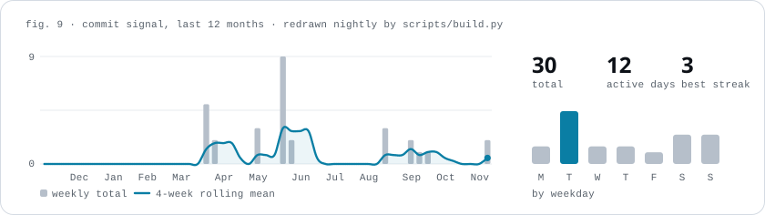

<picture>
  <source media="(prefers-color-scheme: dark)" srcset="assets/hero-dark.svg">
  
</picture>

<p align="center">
  <a href="https://linkedin.com/in/SakshamKochar">LinkedIn</a>
  &nbsp;·&nbsp;
  <a href="mailto:skochar3@asu.edu">skochar3@asu.edu</a>
  &nbsp;·&nbsp;
  <a href="https://orcid.org/0009-0005-9531-2916">ORCID</a>
  &nbsp;·&nbsp;
  <a href="https://recompute.life">recompute.life</a>
</p>

## Model card

```yaml
model: saksham-kochar
base: B.S. Data Science (Computer Science track), Arizona State University, class of 2028
checkpoints:
  - Blink Charging · Data Science Intern · 2026 to now
  - Saxo Bank · Product Development Intern · 2025
  - ASU School of Mathematical and Statistical Sciences · Undergraduate Research Assistant · 2025
fine_tuned_on: [EV charger logs, 9M Reddit posts, ten years of Google Trends, GPU resale markets]
evals:
  gpa: 3.86
  deans_list: every semester
also_serving:
  - Academic Officer, The AI Society at ASU
  - Instructional Aide, ASU Math and Statistics
intended_use: questions where the data is messy and the answer has to ship
known_limitations:
  - will re-derive your KPI if the definition looks too good to be true
  - cannot leave an axis unlabeled
license: open to Summer 2027 data science and ML internships
```

## Selected work

<table>
  <tr>
    <td width="50%" valign="top">
      <picture>
        <source media="(prefers-color-scheme: dark)" srcset="assets/blink-dark.svg">
        
      </picture>
      <h3>Charging reliability toolkit</h3>
      <p><b>Blink Charging · Data Science Intern</b></p>
      <p>Root-cause analysis on raw OCPP 1.6 charger logs: a 10-category session classifier, a decoder for a 128-bit vendor fault field, and a full-stack app on top so engineers can use it. I also redefined the session success KPI so it measures real plug-in attempts.</p>
      <p><code>Python</code> <code>SQL</code> <code>FastAPI</code> <code>React</code> <code>TypeScript</code> <code>Parquet</code></p>
    </td>
    <td width="50%" valign="top">
      <picture>
        <source media="(prefers-color-scheme: dark)" srcset="assets/recompute-dark.svg">
        
      </picture>
      <h3><a href="https://github.com/SakshamKochar/Recompute">ReCompute</a></h3>
      <p><b>Finalist, ASU Reverse the Future · team of four</b></p>
      <p>What should happen to a retired GPU server? I built the decision model that scores seven routes for every machine, from selling today to hosting longer to harvesting parts. On a 100-server test fleet it found 6.3% more value than the default routes and rerouted 49 machines.</p>
      <p><code>Python</code> <code>FastAPI</code> <code>SQLAlchemy</code> <code>Docker</code> <code>Vite</code></p>
    </td>
  </tr>
  <tr>
    <td width="50%" valign="top">
      <picture>
        <source media="(prefers-color-scheme: dark)" srcset="assets/lifeops-dark.svg">
        
      </picture>
      <h3><a href="https://github.com/anadidewan/lifeOps">LifeOps</a></h3>
      <p><b>A scheduling engine for your actual day</b></p>
      <p>A deterministic planner: it ranks tasks by urgency and importance, treats meetings as fixed, finds the open windows and packs work into focus blocks. Timezone-aware daily plans behind authenticated REST APIs.</p>
      <p><code>FastAPI</code> <code>PostgreSQL</code> <code>SQLAlchemy</code> <code>Firebase Auth</code></p>
    </td>
    <td width="50%" valign="top">
      <picture>
        <source media="(prefers-color-scheme: dark)" srcset="assets/research-dark.svg">
        
      </picture>
      <h3>How America talks about mental health</h3>
      <p><b>Independent research · sole author</b></p>
      <p>Ten years of Google Trends and about 9 million Reddit posts on ADHD, depression, trauma and burnout, to measure how the language around each one shifted. Burnout searches roughly doubled by 2025. Preprint in submission.</p>
      <p><code>Python</code> <code>pandas</code> <code>NLP</code> <code>time series</code> <code>LaTeX</code></p>
    </td>
  </tr>
  <tr>
    <td width="50%" valign="top">
      <picture>
        <source media="(prefers-color-scheme: dark)" srcset="assets/fairclaim-dark.svg">
        
      </picture>
      <h3>FairClaim</h3>
      <p><b>A labor justice platform</b></p>
      <p>Connects workers who were treated unfairly with lawyers who can help. Three role-based dashboards, motion-driven UI, and copy written carefully around the line between legal information and legal advice.</p>
      <p><code>React</code> <code>TypeScript</code> <code>Vite</code> <code>Framer Motion</code></p>
    </td>
    <td width="50%" valign="top">
      <picture>
        <source media="(prefers-color-scheme: dark)" srcset="assets/play-dark.svg">
        
      </picture>
      <h3>Side quests</h3>
      <p><b>Built because they were fun</b></p>
      <p><a href="https://github.com/SakshamKochar/novatrack">NovaTrack</a>, an AR stargazing app I made for my sister. Neon Akhara II, a cyberpunk fighting game set in an Indian wrestling arena, in one Three.js file with procedural audio. HandRave, a webcam gesture controller for music.</p>
      <p><code>React</code> <code>Three.js</code> <code>Web Audio</code> <code>MediaPipe</code></p>
    </td>
  </tr>
</table>

## Stack

<picture>
  <source media="(prefers-color-scheme: dark)" srcset="assets/pipeline-dark.svg">
  
</picture>

## Activity

<picture>
  <source media="(prefers-color-scheme: dark)" srcset="assets/activity-dark.svg">
  
</picture>

<p align="center">
  <sub>Every figure on this page is drawn by <a href="scripts/build.py">one Python script</a> in this repo. No templates, no third-party widgets. The activity chart redraws itself from live data every night.</sub>
</p>
