<picture>
  <source media="(prefers-color-scheme: dark)" srcset="assets/hero-dark.svg">
  
</picture>

<p align="center">
  <a href="https://saksham-kochar-portfolio.vercel.app"><b>Portfolio</b></a>
  &nbsp;·&nbsp;
  <a href="https://www.linkedin.com/in/saksham-kochar-95555030a">LinkedIn</a>
  &nbsp;·&nbsp;
  <a href="mailto:skochar3@asu.edu">skochar3@asu.edu</a>
  &nbsp;·&nbsp;
  <a href="https://recompute.life">recompute.life</a>
</p>

<picture>
  <source media="(prefers-color-scheme: dark)" srcset="assets/highlights-dark.svg">
  
</picture>

## About

I'm a junior studying Data Science at Arizona State University. The part of the work I like most is the stretch between a messy log file and a number someone can trust, and then the stretch after that, where the number becomes a tool people actually open.

Right now that means three things: charger reliability and energy cost tools at Blink Charging, a decision engine for retired GPU servers that took 3rd place at ASU's Reverse the Future challenge, and a sole-author study of ten years of mental health discourse. More of my work lives on my [portfolio](https://saksham-kochar-portfolio.vercel.app).

## Model card

```yaml
model: saksham-kochar
base: B.S. Data Science (Computer Science track), Arizona State University, class of 2028
checkpoints:
  - Blink Charging · Data Science Intern · 2026 to now
  - Saxo Bank · Product Development Intern · 2025
  - ASU School of Mathematical and Statistical Sciences · Undergraduate Research Assistant · 2025
fine_tuned_on: [EV charger logs, 9M Reddit posts, ten years of Google Trends, GPU resale markets]
evals:
  gpa: 3.86
  deans_list: every semester
  awards: 3rd place, ASU Reverse the Future 2026 ($3,000 prize)
also_serving:
  - Academic Officer, The AI Society at ASU
  - Instructional Aide, ASU Math and Statistics
intended_use: questions where the data is messy and the answer has to ship
known_limitations:
  - will re-derive your KPI if the definition looks too good to be true
  - cannot leave an axis unlabeled
license: open to Summer 2027 data science and ML internships
```

## Training log

<picture>
  <source media="(prefers-color-scheme: dark)" srcset="assets/training-dark.svg">
  
</picture>

## Blink Charging · Data Science Intern

I work on the data behind a fleet of EV chargers. Two tools so far, each built end to end, from raw data to something an engineer can click through.

<picture>
  <source media="(prefers-color-scheme: dark)" srcset="assets/blink-decode-dark.svg">
  
</picture>

### 1. Charging reliability and root-cause analysis

Chargers speak OCPP 1.6: a flat stream of JSON messages with no concept of a customer visit. This tool turns that stream into answers about what happened and why.

- **Pipeline.** Parses hundreds of thousands of raw messages into typed events. Along the way I found and fixed a deduplication bug where CRC16 hash collisions were silently discarding distinct messages, and a timestamp bug where offline chargers delivered queued transactions late and produced impossible session lengths.
- **Visit reconstruction.** Matches transactions and merges repeated plug and replug attempts on a connector into one visit, so hundreds of noisy plug events collapse into the handful of real visits behind them.
- **A better success metric.** Replaced a single top-line success number with a four-layer framework that measures reliability at each step of the customer journey, from plug-in to completed session.
- **Why visits fail.** Engineered a per-charger feature matrix of 20+ features to rank what predicts a failed visit, and to rule out the factors that don't.
- **Ten-outcome classifier.** Designed a taxonomy, refined with my supervisor from six categories to ten, that gives every visit exactly one actionable outcome. Integrated a 128-bit bitmask decoder that turns opaque hex vendor codes into named hardware faults.
- **Shipped as an app.** A Python pipeline into SQLite, a FastAPI backend, and a React and TypeScript frontend with an overview dashboard, a searchable visits explorer, per-visit timelines and a per-charger health view. An automated data-quality guard caught a real anomaly in the data on its own.

<p><code>Python</code> <code>pandas</code> <code>SQLite</code> <code>FastAPI</code> <code>React</code> <code>TypeScript</code> <code>OCPP 1.6</code></p>

<picture>
  <source media="(prefers-color-scheme: dark)" srcset="assets/blink-energy-dark.svg">
  
</picture>

### 2. Energy and cost management

Revenue per site is easy to see. Electricity cost per site is not. This tool rebuilds each location's energy profile and estimates cost, revenue and margin, so the team can decide where energy controls are worth tuning.

- **Ingestion.** A pipeline over more than a year of hourly Apache Parquet usage data. It handles the quirks real hardware data comes with: serial numbers that repeat across locations after chargers are re-provisioned (so the join key has to be charger id), and a nonstandard 12-hour clock that needed its own parser.
- **Rollups.** Utilization, single-charger versus true site-level peak demand, coincidence factor against installed capacity, hour-of-day load profiles, and a weekday-by-hour demand heatmap.
- **Cost model.** An editable time-of-use and demand-charge model, per site and per month. Its key output is a demand-share-of-cost signal that flags sites where short spikes dominate the bill, which is where peak shaving pays off most.
- **Delivery.** An 11-endpoint FastAPI backend and a dashboard drawn in hand-written SVG with vanilla JavaScript.

<p><code>Python</code> <code>Apache Parquet</code> <code>FastAPI</code> <code>JavaScript</code> <code>SVG</code></p>

<sub>Both figures use synthetic data. Fleet numbers and reliability figures stay inside Blink.</sub>

## ReCompute · 3rd place, ASU Reverse the Future

<picture>
  <source media="(prefers-color-scheme: dark)" srcset="assets/recompute-dark.svg">
  
</picture>

When a data center retires a GPU server, it usually gets sold on a default route. [ReCompute](https://github.com/SakshamKochar/Recompute) asks what the best next life for each machine actually is. I led decision modeling on a team of four.

- **The model.** Every server gets seven routes scored: sell now, list and wait, rent while listed, host longer, repair, harvest parts, or recycle. Each call is stress-tested under bear, base and bull markets, with the flip point that would change it.
- **The result.** On a 100-server test fleet priced with real market data, it rerouted 49 machines and found over $500K in extra modeled value, 6.3% more than the default routes.
- **The product.** A decision studio around the model: a What-if Lab that re-runs the model as you change inputs, fleet-wide planning with a review-and-commit step, and a Decision Replay that shows the one change that would have flipped a call.
- **The outcome.** 3rd place and a $3,000 prize. Live at [recompute.life](https://recompute.life).

<p><code>Python</code> <code>FastAPI</code> <code>SQLAlchemy</code> <code>SQLite</code> <code>Vite</code> <code>Docker</code></p>

## Projects

### [LifeOps](https://github.com/anadidewan/lifeOps)

<picture>
  <source media="(prefers-color-scheme: dark)" srcset="assets/lifeops-dark.svg">
  
</picture>

**A scheduling engine for your actual day · in active build since April 2026**

Most planners hand you a list. LifeOps hands you a day. You give it tasks and it gives back a schedule that already respects your meetings, your time zone and how long you can really focus.

- **Scheduling engine.** Deterministic, so the same inputs always produce the same plan. It scores and ranks tasks by urgency and importance, treats meetings as fixed constraints, computes the open windows between them and allocates work into configurable focus blocks.
- **Backend.** A modular FastAPI service on PostgreSQL and SQLAlchemy, with relational models and REST APIs for users, tasks, meetings, schedules and external integrations.
- **Auth and planning APIs.** Firebase Authentication in front of CRUD and planning endpoints that generate timezone-aware daily plans on request.

<p><code>FastAPI</code> <code>PostgreSQL</code> <code>SQLAlchemy</code> <code>Firebase Auth</code></p>

<br clear="both">

### How America talks about mental health, 2015 to 2025

<picture>
  <source media="(prefers-color-scheme: dark)" srcset="assets/research-dark.svg">
  
</picture>

**Independent research · sole author · preprint in submission**

A quantitative text analysis of how the public language around ADHD, depression, trauma and burnout changed over a decade, and how far it drifted from the academic definitions.

- **Data.** Ten years of U.S. Google Trends, about 9 million Reddit posts and comments from condition-specific communities, and the academic literature for each term over the same period.
- **Methods.** Time-series analysis of search interest, plus sentiment and vocabulary analysis of community language: clinical terms, identity language and recovery language.
- **Findings.** Search interest in ADHD and trauma roughly tripled and never returned to pre-pandemic levels. Depression stayed the most searched term but drifted down after 2022. Burnout kept reaching higher peaks from a low base.
- **Contribution.** Four discourse models, one per community: identity and advocacy (ADHD), crisis expression (depression), clinical and emotional integration (trauma), and political mobilization (burnout). Across all four, public awareness grew faster than access to care.

<p><code>Python</code> <code>pandas</code> <code>VADER</code> <code>NLP</code> <code>time series</code> <code>LaTeX</code></p>

<br clear="both">

### FairClaim

<picture>
  <source media="(prefers-color-scheme: dark)" srcset="assets/fairclaim-dark.svg">
  
</picture>

**A labor justice platform**

Workers who are owed wages often cannot find or afford the right lawyer. FairClaim connects them with licensed, specialized attorneys and keeps the case organized from the first intake to the match.

- **Three products in one.** Separate dashboards for workers, lawyers and admins, each with its own navigation and views.
- **Built around the legal line.** A two-tier model: supervised case guides handle intake, document organization and general legal information, while licensed attorneys give all advice. I researched that distinction first, then wrote it into the copy, the trust section and the disclaimers.
- **Interface.** A clean, minimal design system with layered depth, and a hero built from a stack of case cards that tilts in 3D with the cursor using Framer Motion springs.

<p><code>React</code> <code>TypeScript</code> <code>Vite</code> <code>Framer Motion</code></p>

<br clear="both">

### Side quests

<picture>
  <source media="(prefers-color-scheme: dark)" srcset="assets/play-dark.svg">
  
</picture>

**Built because they were fun**

- **HandRave.** A music controller you play with your hands. It tracks hand landmarks from a live webcam with MediaPipe, classifies gestures frame by frame (open palm, fist, pinch, fast motion, two hands) and maps them to sound across five modes, from beats and synths to bass drops.
- **Neon Akhara II.** A cyberpunk fighting game set in a reimagined Indian wrestling arena, written as a single Three.js file. Procedural audio, gamepad support, per-player device detection, and full control remapping that uses physical key codes so it works on any keyboard layout.

<p><code>MediaPipe</code> <code>Three.js</code> <code>Web Audio</code> <code>JavaScript</code></p>

<br clear="both">

## Stack

<picture>
  <source media="(prefers-color-scheme: dark)" srcset="assets/pipeline-dark.svg">
  
</picture>

## More experience

**Saxo Bank · Product Development Intern** (Innovation and Strategy team, May to August 2025)

- Cleaned, prepared and enhanced 200+ financial education resources with Python and Excel, which made the data consistent and sped up reporting for internal teams.
- Built structured tagging and reconciliation frameworks in Excel to validate content metadata and cut manual review.
- Ran exploratory analysis on anonymized interaction logs and usability data to find trends, data gaps and process inefficiencies for the product and engineering teams.

**The AI Society at ASU · Academic Officer** (previously Logistics and Communications Lead, since July 2025)

- Coordinated 30+ AI and ML workshops, technical bootcamps and guest speaker events that reached 350+ students across disciplines.
- Led 5+ MakerSpace sprints and paper reading groups on LLMs, prompt engineering and computer vision, which produced four working student prototypes.

**ACM at ASU · Logistics and Communications Lead** (July to December 2025)

- Ran technical workshops and events with faculty and industry speakers across three campuses.
- Set up Trello task boards for 20+ events, cutting planning time by 15% and making volunteer hours and attendance trackable.

**ASU School of Mathematical and Statistical Sciences · Instructional Aide** (Fall 2026)

## Earlier builds

- **Rant!** A cross-platform app for voice notes that disappear once they are played, co-built with three other developers, from Figma mocks through Flask APIs. 50,000+ voice notes exchanged in the first three months, and a 12% lift in downloads after a data-informed interface revamp. <code>React</code> <code>Flask</code> <code>Firebase</code> <code>MySQL</code>
- **Demic.** A mobile app that let remote students study and socialize together during COVID. I built the social layer and analyzed message metadata in SQL to see which features people adopted. 50+ active users in the first month at my high school. <code>React Native</code> <code>TypeScript</code> <code>Cloud Firestore</code>

## Off the clock

Drawing, and cooking the Punjabi and Hyderabadi food I grew up on.

<p align="center">
  <sub>Every figure on this page is drawn by <a href="scripts/build.py">one Python script</a> in this repo. No templates, no third-party widgets.</sub>
</p>
