<picture>
  <source media="(prefers-color-scheme: dark)" srcset="assets/hero-dark.svg">
  
</picture>

<p align="center">
  <a href="https://linkedin.com/in/SakshamKochar">LinkedIn</a>
  &nbsp;·&nbsp;
  <a href="mailto:skochar3@asu.edu">skochar3@asu.edu</a>
  &nbsp;·&nbsp;
  <a href="https://orcid.org/0009-0005-9531-2916">ORCID</a>
  &nbsp;·&nbsp;
  <a href="https://recompute.life">recompute.life</a>
</p>

<picture>
  <source media="(prefers-color-scheme: dark)" srcset="assets/highlights-dark.svg">
  
</picture>

## Model card

```yaml
model: saksham-kochar
base: B.S. Data Science (Computer Science track), Arizona State University, class of 2028
checkpoints:
  - Blink Charging · Data Science Intern · 2026 to now
  - Saxo Bank · Product Development Intern · 2025
  - ASU School of Mathematical and Statistical Sciences · Undergraduate Research Assistant · 2025
fine_tuned_on: [EV charger logs, 9M Reddit posts, ten years of Google Trends, GPU resale markets]
evals:
  gpa: 3.86
  deans_list: every semester
  awards: 3rd place, ASU Reverse the Future 2026 ($3,000 prize)
also_serving:
  - Academic Officer, The AI Society at ASU
  - Instructional Aide, ASU Math and Statistics
intended_use: questions where the data is messy and the answer has to ship
known_limitations:
  - will re-derive your KPI if the definition looks too good to be true
  - cannot leave an axis unlabeled
license: open to Summer 2027 data science and ML internships
```

## Training log

<picture>
  <source media="(prefers-color-scheme: dark)" srcset="assets/training-dark.svg">
  
</picture>

## Blink Charging · Data Science Intern

I work on the data behind a fleet of EV chargers. Two tools so far, each built end to end, from raw data to something an engineer can click through.

<picture>
  <source media="(prefers-color-scheme: dark)" srcset="assets/blink-decode-dark.svg">
  
</picture>

### 1. Charging reliability and root-cause analysis

Chargers speak OCPP 1.6: a flat stream of JSON messages with no concept of a customer visit. This tool turns that stream into answers about what happened and why.

- **Pipeline.** Parses hundreds of thousands of raw messages into typed events. Along the way I found and fixed a deduplication bug where CRC16 hash collisions were silently discarding distinct messages, and a timestamp bug where offline chargers delivered queued transactions late and produced impossible session lengths.
- **Visit reconstruction.** Matches transactions and merges repeated plug and replug attempts on a connector into one visit, so hundreds of noisy plug events collapse into the handful of real visits behind them.
- **A better success metric.** Replaced a single top-line success number with a four-layer framework that measures reliability at each step of the customer journey, from plug-in to completed session.
- **Why visits fail.** Engineered a per-charger feature matrix of 20+ features to rank what predicts a failed visit, and to rule out the factors that don't.
- **Ten-outcome classifier.** Designed a taxonomy, refined with my supervisor from six categories to ten, that gives every visit exactly one actionable outcome. Integrated a 128-bit bitmask decoder that turns opaque hex vendor codes into named hardware faults.
- **Shipped as an app.** A Python pipeline into SQLite, a FastAPI backend, and a React and TypeScript frontend with an overview dashboard, a searchable visits explorer, per-visit timelines and a per-charger health view. An automated data-quality guard caught a real anomaly in the data on its own.

<p><code>Python</code> <code>pandas</code> <code>SQLite</code> <code>FastAPI</code> <code>React</code> <code>TypeScript</code> <code>OCPP 1.6</code></p>

<picture>
  <source media="(prefers-color-scheme: dark)" srcset="assets/blink-energy-dark.svg">
  
</picture>

### 2. Energy and cost management

Revenue per site is easy to see. Electricity cost per site is not. This tool rebuilds each location's energy profile and estimates cost, revenue and margin, so the team can decide where energy controls are worth tuning.

- **Ingestion.** A pipeline over more than a year of hourly Apache Parquet usage data. It handles the quirks real hardware data comes with: serial numbers that repeat across locations after chargers are re-provisioned (so the join key has to be charger id), and a nonstandard 12-hour clock that needed its own parser.
- **Rollups.** Utilization, single-charger versus true site-level peak demand, coincidence factor against installed capacity, hour-of-day load profiles, and a weekday-by-hour demand heatmap.
- **Cost model.** An editable time-of-use and demand-charge model, per site and per month. Its key output is a demand-share-of-cost signal that flags sites where short spikes dominate the bill, which is where peak shaving pays off most.
- **Delivery.** An 11-endpoint FastAPI backend and a dashboard drawn in hand-written SVG with vanilla JavaScript.

<p><code>Python</code> <code>Apache Parquet</code> <code>FastAPI</code> <code>JavaScript</code> <code>SVG</code></p>

<sub>Both figures use synthetic data. Fleet numbers and reliability figures stay inside Blink.</sub>

## ReCompute · 3rd place, ASU Reverse the Future

<picture>
  <source media="(prefers-color-scheme: dark)" srcset="assets/recompute-dark.svg">
  
</picture>

When a data center retires a GPU server, it usually gets sold on a default route. [ReCompute](https://github.com/SakshamKochar/Recompute) asks what the best next life for each machine actually is. I led decision modeling on a team of four.

- **The model.** Every server gets seven routes scored: sell now, list and wait, rent while listed, host longer, repair, harvest parts, or recycle. Each call is stress-tested under bear, base and bull markets, with the flip point that would change it.
- **The result.** On a 100-server test fleet priced with real market data, it rerouted 49 machines and found over $500K in extra modeled value, 6.3% more than the default routes.
- **The product.** A decision studio around the model: a What-if Lab that re-runs the model as you change inputs, fleet-wide planning with a review-and-commit step, and a Decision Replay that shows the one change that would have flipped a call.
- **The outcome.** 3rd place and a $3,000 prize. Live at [recompute.life](https://recompute.life).

<p><code>Python</code> <code>FastAPI</code> <code>SQLAlchemy</code> <code>SQLite</code> <code>Vite</code> <code>Docker</code></p>

## More work

<table>
  <tr>
    <td width="50%" valign="top">
      <picture>
        <source media="(prefers-color-scheme: dark)" srcset="assets/lifeops-dark.svg">
        
      </picture>
      <h3><a href="https://github.com/anadidewan/lifeOps">LifeOps</a></h3>
      <p><b>A scheduling engine for your actual day</b></p>
      <p>A deterministic planner: it ranks tasks by urgency and importance, treats meetings as fixed, finds the open windows and packs work into focus blocks. Timezone-aware daily plans behind authenticated REST APIs.</p>
      <p><code>FastAPI</code> <code>PostgreSQL</code> <code>SQLAlchemy</code> <code>Firebase Auth</code></p>
    </td>
    <td width="50%" valign="top">
      <picture>
        <source media="(prefers-color-scheme: dark)" srcset="assets/research-dark.svg">
        
      </picture>
      <h3>How America talks about mental health</h3>
      <p><b>Independent research · sole author</b></p>
      <p>Ten years of Google Trends and about 9 million Reddit posts on ADHD, depression, trauma and burnout, to measure how the language around each one shifted. Burnout searches roughly doubled by 2025. Preprint in submission.</p>
      <p><code>Python</code> <code>pandas</code> <code>NLP</code> <code>time series</code> <code>LaTeX</code></p>
    </td>
  </tr>
  <tr>
    <td width="50%" valign="top">
      <picture>
        <source media="(prefers-color-scheme: dark)" srcset="assets/fairclaim-dark.svg">
        
      </picture>
      <h3>FairClaim</h3>
      <p><b>A labor justice platform</b></p>
      <p>Connects workers who were treated unfairly with lawyers who can help. Three role-based dashboards, motion-driven UI, and copy written carefully around the line between legal information and legal advice.</p>
      <p><code>React</code> <code>TypeScript</code> <code>Vite</code> <code>Framer Motion</code></p>
    </td>
    <td width="50%" valign="top">
      <picture>
        <source media="(prefers-color-scheme: dark)" srcset="assets/play-dark.svg">
        
      </picture>
      <h3>Side quests</h3>
      <p><b>Built because they were fun</b></p>
      <p><a href="https://github.com/SakshamKochar/novatrack">NovaTrack</a>, an AR stargazing app I made for my sister. Neon Akhara II, a cyberpunk fighting game set in an Indian wrestling arena, in one Three.js file with procedural audio. HandRave, a webcam gesture controller for music.</p>
      <p><code>React</code> <code>Three.js</code> <code>Web Audio</code> <code>MediaPipe</code></p>
    </td>
  </tr>
</table>

## Stack

<picture>
  <source media="(prefers-color-scheme: dark)" srcset="assets/pipeline-dark.svg">
  
</picture>

## Also

- **The AI Society at ASU.** Academic Officer. Before that I ran logistics for 30+ workshops, bootcamps and speaker events that reached 350+ students, and led MakerSpace sprints and paper reading groups on LLMs and computer vision.
- **Teaching.** Instructional Aide for the ASU School of Mathematical and Statistical Sciences.
- **Earlier builds.** Rant!, a disappearing voice-note app built with three other developers (50,000+ voice notes in its first three months), and Demic, a study app that reached 50+ users at my high school.
- **Off the clock.** Drawing, and cooking the Punjabi and Hyderabadi food I grew up on.

<p align="center">
  <sub>Every figure on this page is drawn by <a href="scripts/build.py">one Python script</a> in this repo. No templates, no third-party widgets.</sub>
</p>
